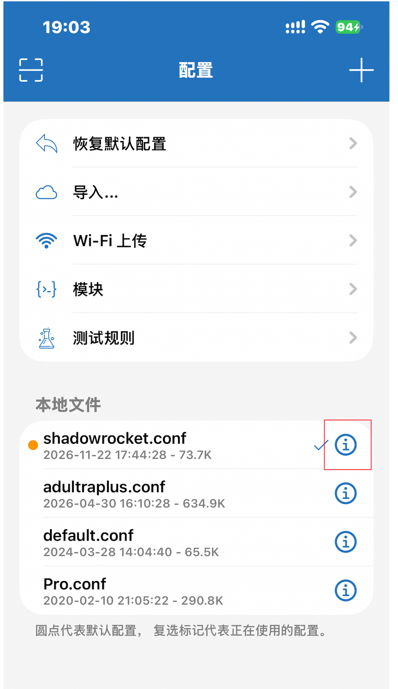
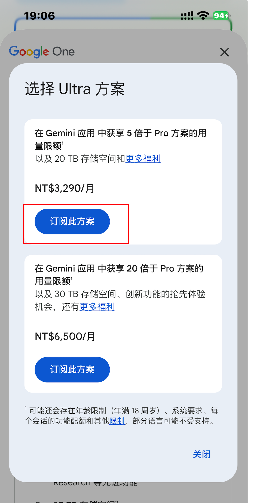

# g1-acq

[](https://t.me/muihbb)

> 💬 **Telegram Community**: https://t.me/muihbb — Discussing AI deals and subscription promotions.

A Google One (iOS) subscription product ID (SKU) rewriter and passive collector for **Shadowrocket**.

**All you need is a single G1 ACQ module: supports Ultra 1-month free trial, 2TB 12-month promo testing, passive original SKU collection, recent 10-response activity diagnostics, newly added vs. duplicate tracking, and JSON export.** The original iOS 2TB SKU maps to `g1.2tb.ai.12months_ip_90p` (a user-specified 12-month promotional candidate from a screenshot), while 20TB / 30TB default to the Ultra 1-month free trial SKUs `g1.20tb.1month_eft.acq` / `g1.ai.ultra.1month_eft.acq` and each independently falls back to its corresponding 3-month 90p promo SKU. The current release is `v7.6.0` with response script `g1-acq-v7.6`—no separate scanner or module switching is required. Collection only reads matching responses actually received by the device and **does not actively query the full SKU catalog**; when a previously seen ID reappears, its occurrence count increments while the unique list length stays unchanged, which still confirms duplicate data is being received. For full installation and on-device verification instructions, see [Pro 12-Month Promo Testing and SKU Scanning](docs/pro-annual-test.md).

This release incorporates [GitHub PR #3](https://github.com/crhywun/g1-acq/pull/3), adding 20TB / 30TB Ultra 1-month free trial support. Whether a free trial is shown to a given account, along with actual billing intervals and renewal pricing, must be verified on the App Store checkout sheet, and entitlements must be confirmed from the Google One account status.

> Seeing a product ID in an HTTP response only proves the page payload contains that string—it is not an App Store catalog validation. A rewrite match does not guarantee the product is purchasable; verify the product name, billing period, introductory price, and renewal price on the App Store purchase sheet, and confirm final benefits in your Google One account.

## Main Module Install URL

**G1 ACQ: Ultra 1-Month Free Trial, 2TB 12-Month Promo Test, Passive Collection & Response Diagnostics**

```text
https://cdn.jsdelivr.net/gh/crhywun/g1-acq@v7.6.0/g1-acq-v7.sgmodule
```

For a first-time install, add the URL above in Shadowrocket's Module manager and enable it. To upgrade from an earlier version, replace the old **G1 ACQ** module URL with this URL once. Both the module installer and its internal response/report scripts are pinned to `@v7.6.0`, so you do not need to add individual scripts manually. After installing or upgrading, reconnect Shadowrocket and reopen the subscription page in the Google App. Publishing a new release requires updating both the script contents and the pinned version tag; merging a PR does not automatically update or invalidate older pinned CDN URLs, which continue serving their original version. Upgrading preserves local history; response diagnostics do not guarantee new IDs, and reinstalling will not cause the server to send new SKUs.

Only keep this single **G1 ACQ** module enabled. If you previously installed the standalone **G1 SKU Scan**, **G1 Pro Annual Test**, or other rewrite copies, disable those legacy copies to avoid duplicate counting or rewriting; if you only have the main module installed, no extra cleanup is needed. Historical tags `v7.0.0` / `v7.1.0` / `v7.2.0` / `v7.3.0` / `v7.4.0` / `v7.5.0` and `pro-annual-test-v1` / `pro-annual-test-v2` remain untouched.

Recent 10-response diagnostics are provided by the main script `g1-acq-v7.6`. The **G1 Pro Annual Test** compatibility module also points to this script, but still only matches `/ai?`. The standalone **G1 SKU Scan** compatibility module only updates its download pin; its script retains the legacy `pro-annual-test-v2` collector without response activity diagnostics. When the new report reads those legacy records, it displays **Legacy collection record** with an empty response history.

## Three-Tier Mapping

The script first collects SKUs from raw text responses under `one.google.com/`, then applies the following full-token mappings only to responses matching `one.google.com/ai?`:

| Complete Source SKU in Body | Default Target | Fallback Target |
|---|---|---|
| Complete SKU with prefix `g1.ios.2tb.` | `g1.2tb.ai.12months_ip_90p` (user-specified candidate) | None |
| `g1.ios.20tb.m.v2` | `g1.20tb.1month_eft.acq` (Ultra 1-month free trial) | `g1.20tb.3months_ip_90p.acq` (3-month 90p promo) |
| `g1.ios.30tb.ai.pro.m` | `g1.ai.ultra.1month_eft.acq` (Ultra 1-month free trial) | `g1.ai.ultra.3months_ip_90p.acq` (3-month 90p promo) |

The source product for the 2TB 12-month promo test is the **original iOS 2TB SKU**, with a fixed target and no fallback tier. For 20TB and 30TB, each tier independently chooses its target based on the raw response body: if that tier's `1month_eft` default target appears in the body, it is selected even if the 90p fallback also appears; it falls back to 90p only when the default target is absent and the corresponding 90p fallback is present; if neither appears, it still uses the `1month_eft` default target. 75p is no longer a fallback target in this version, though historical records containing `g1.20tb.3months_ip_75p.acq` or `g1.ai.ultra.3months_ip_75p.acq` are preserved as-is. This decision is based purely on strings observed in the response body, not an App Store catalog query. If none of the three tiers match, the response passes through unchanged.

**The 2TB candidate is fixed as `g1.2tb.ai.12months_ip_90p`, with no `.acq` suffix.** The first entry in the user's screenshot shows this candidate with the price label `$1.99 × 12 months = $23.88/year`, indicating a promotional monthly price across 12 consecutive months. Here `90p` means **90% off** (paying ~10%), not paying 90%. `$23.88/year` is a 12-month total label from the screenshot, not proof of a single upfront annual charge.

Although the screenshot title says **Pro 5TB**, the source SKU in this test remains complete SKUs prefixed with `g1.ios.2tb.` (no new 5TB source prefix has been added). The screenshot is only the source of the candidate ID and price label—it is not verified iOS App Store product metadata and does not prove actual iOS pricing, billing intervals, or 5TB entitlements. Verify actual product names, billing cycles, introductory/renewal amounts on the App Store checkout sheet, and check entitlements in your Google One account. Offline tests verify string matching and report behavior.

## Installation (Shadowrocket)

Navigate to **Config → tap the `(i)` icon next to your active config → HTTPS Decryption**.



1. Enable the **G1 ACQ** module installed from the `v7.6.0` URL above in Shadowrocket's Module manager (existing users should upgrade once as described above) and keep the VPN connected on the home tab.
2. Open **HTTPS Decryption** via the active config's **(i)** button and toggle decryption on. If you already have a valid, trusted Shadowrocket certificate, reuse it; otherwise, generate and install a certificate on that page and complete the next two steps.
3. For first-time certificate setup, go to iOS **Settings → General → VPN & Device Management** and install the Shadowrocket profile.
4. For first-time certificate setup, go to iOS **Settings → General → About → Certificate Trust Settings** and enable full trust for the Shadowrocket root certificate.
5. Verify that `one.google.com` appears in the active config's **HTTPS Decryption hostname list** (the module adds it via `%APPEND%`). Note that this is the HTTPS Decryption list, not DNS Hosts.
6. After installing a module or changing module/decryption settings, reconnect Shadowrocket and then reopen the subscription page in the Google App.

## On-Device Workflow

1. Keep the updated **G1 ACQ** module enabled and Shadowrocket connected; collection and rewriting run automatically in sequence whenever matching responses arrive.
2. Open the **Google App (colorful G icon) → Manage Google One**, enter the **2TB / Pro** plan to test the 12-month offer, and open any **20TB / 30TB** plans shown to verify the Ultra 1-month free trial mapping.
3. When entering the subscription flow, verify the product name, billing period, introductory price, and renewal price on the App Store purchase sheet. Paste the full [Local Report URL](https://one.google.com/g1-sku-report) into Safari's address bar to inspect original candidate SKUs and rewrite records, then tap **Export JSON** in the action bar.



The screenshot shows a 20TB entry; for the 2TB 12-month promo test, open the **2TB / Pro** plan. Available plans depend on account, region, and app version—use whatever plans are actually presented on your device. Native StoreKit sheets themselves are outside the scope of web response rewriting.

When you browse plans and receive matching responses, the main module first extracts `g1.*` and `com.google.one.*` tokens from the raw response body, deduplicates by ID while accumulating counts up to a cap of **300 unique IDs**, and only then performs the three-tier rewrite for `/ai?` responses. Duplicate IDs only update counts and timestamps; once the cap is reached, existing IDs continue updating while newly omitted IDs are counted separately. Collection records original pre-rewrite IDs and skips the local report page—no separate scanner is needed. Only candidate IDs, counts, timestamps, scan status, and up to 10 path-redacted response events are saved locally; full response bodies are never stored, App Store APIs are not queried, and no telemetry is sent.

To discover SKUs that are not visibly displayed in the UI, browse each monthly, annual, and promotional entry available in the Google App: any product ID present in the raw HTTP response is collected even if hidden on screen. IDs never sent by the server will not appear in the raw list; specified candidates are substituted by the module and verified in the native App Store checkout sheet. See [SKU Collection and Candidate Verification](docs/pro-annual-test.md#6-collecting-and-verifying-hidden-skus-in-ios-shadowrocket) for full iOS instructions.

## Local Report & Troubleshooting

With **G1 ACQ** enabled and Shadowrocket connected, paste the full [Local Report URL](https://one.google.com/g1-sku-report) into Safari's address bar. The top of the page should display the **Local script active** and **v7.6.0** badge along with an **Export JSON** button; you can also open the [JSON Export URL](https://one.google.com/g1-sku-report?format=json) directly.

Although the URL uses `one.google.com`, the page is generated locally on your device by a Shadowrocket `http-request` script—**it is not served by Google**. The script intercepts `/g1-sku-report`, `/g1-sku-report/`, and any query parameters on that path, returning HTML or JSON directly without forwarding the request to Google.

If you see a normal Google page, a 404, or a page without the local badge and export button, the local report script did not intercept the request. Check that the updated module is enabled, Shadowrocket is connected, **Active Config `(i)` → HTTPS Decryption** is on, `one.google.com` is in the hostname list, and the root certificate is trusted, then paste the full URL into Safari's address bar again.

`reportVersion=v7.6.0` only identifies the report script version—**it does not prove the new collector has received any responses**. The report separately shows the persisted `scan.version`, latest timestamp, and response history; the current collector is `g1-acq-v7.6`. Records from older scripts display **Legacy collection record; no response activity from this version has been saved yet.** Unknown versions or empty storage display **No response activity from this version has been saved yet.** Legacy records lacking `recentResponses` will not have fabricated history injected and do not indicate a device failure.

| Collection Field | Meaning |
|---|---|
| `scan.scannedResponses` | Cumulative count of text responses processed (unchanged semantics) |
| `scan.matchedResponses` | Cumulative count of text responses containing at least one candidate ID, including duplicates (unchanged semantics) |
| `scan.nonTextResponses` | Cumulative count of non-text responses (not counted in `scannedResponses`) |
| `scan.recentResponses` | Up to 10 response events; stored oldest → newest in JSON, rendered newest → oldest in HTML; each entry has `{at, path, bodyType, status, candidateCount, addedCount, omittedCount}` |

Within a single event, `candidateCount` is the number of distinct candidate IDs in that response, `addedCount` is the number of newly added IDs retained in storage, and `omittedCount` is the number of distinct new IDs dropped due to the 300-ID cap. Possible statuses are `new-skus` (new IDs added), `known-skus` (duplicates only), `no-skus` (no IDs), `limit-reached` (no additions retained and at least one ID omitted due to cap), and `non-text` (non-text body). When `addedCount > 0`, the status is always `new-skus` even if `omittedCount > 0`; `limit-reached` is used only when `addedCount === 0` and `omittedCount > 0`. Paths are redacted to `/`, `/ai`, `/plans`, `/_/…/data/batchexecute`, or `[other one.google.com path]`—query strings, full URLs, bodies, and request/response headers are never saved.

Top-level `configuredTarget=g1.2tb.ai.12months_ip_90p` reflects the current configuration, whereas `test.version` and `test.target` come from the most recently saved execution record and preserve historical versions/targets across upgrades until a new execution occurs. The current response script is `g1-acq-v7.6`, recording `test.targetOrigin=user-specified`. Legacy v7.5 records share the same 2TB target `g1.2tb.ai.12months_ip_90p` and `user-specified` origin, but retain `test.version=g1-acq-v7.5`—matching targets do not imply the old record was refreshed. Legacy v7.3 / v7.4 records retain `g1.2tb.ai.annual_ip_90p.acq` with `user-specified`; v7.2 retains `g1.2tb.ai.annual.3months_ip_90p.acq` with `pattern-derived`; legacy v1 / v7.1 records retain `g1.2tb.ai.annual` with `legacy`; empty records have an empty origin. Upgrading never relabels historical IDs or origins. `test.target` only refers to the configured 2TB target for that run; check each row's `to` field for actual 20TB / 30TB targets.

`test.hitCount` is the total rewrite count across all three tiers; `test.annualHitCount` preserves the legacy field name and counts only 2TB / Pro promo rewrites (matching `annualHits` in logs and shown as "2TB hits" in the HTML report). Neither the field name nor the count proves annual billing. Each row in `test.matchedFrom` contains `{id, to, count, fallback}`, where `to` is the actual target used for that source SKU and `fallback=true` indicates that version's fallback target was used. In this version, the 20TB / 30TB fallback targets are `g1.20tb.3months_ip_90p.acq` and `g1.ai.ultra.3months_ip_90p.acq`; legacy records may still contain 75p fallbacks. The HTML report displays `90p`, historical `75p`, or `No` based on `fallback` and `to` (or `Yes` if marked fallback without target details), preserving historical rows intact. Even when `fallback=false`, verify `test.version` alongside `to` to interpret the default target.

`status=no-match` means none of the three tiers matched and the response was returned unmodified. If 2TB did not match but 20TB / 30TB did, status is still `rewritten`—check `annualHitCount` to judge 2TB promo rewrites. The report keeps only the most recent rewrite execution record, so verify timestamps carefully and rely on collected IDs rather than guessing new iOS SKUs. The report remains backward-compatible with legacy v1 2TB-only records: rows missing `to` default to `g1.2tb.ai.annual`, and missing `annualHitCount` is summed from legacy 2TB rows. Legacy v1 / v7.1, v7.2, v7.3 / v7.4, and v7.5 records continue displaying their original targets, origins, and versions.

Current script logs use the `[g1-acq]` prefix:

| Log Pattern | Meaning |
|---|---|
| `g1-acq-v7.6 status=<status> addedCount=N candidates=N omittedCount=N occurrences=N saved=yes/no` | Collection status, newly retained IDs, distinct candidates in response, cap-omitted IDs, total token occurrences, and persistence result (`saved=yes` confirms write succeeded) |
| `saved=no` / `SKU collection unavailable` | Storage write failed or collection threw an error; the report may still show stale counts and timestamps, so check logs for these markers |
| `g1-acq-v7.6 hits=N annualHits=N` | Script version, total three-tier rewrites, and 2TB / Pro promo rewrites (legacy log key; does not prove annual billing) |
| `<source SKU> -> <actual target> xN` | Per-source complete ID, actual target applied, and replacement count |
| `fallback=<full target ID>` | Indicates 20TB / 30TB used its fallback tier (`fallback=g1.20tb.3months_ip_90p.acq` or `fallback=g1.ai.ultra.3months_ip_90p.acq` in this release, matching `to`; legacy logs used `fallback=75p`) |

If the candidate list still shows only old SKUs, run a before-and-after activity check:

1. Note `reportVersion`, actual `scan.version`, the three response counters, and the latest event timestamp in the report without clearing the list.
2. Reopen the available **2TB / Pro** plan in the Google App, browse other visible plan pages, and wait for them to finish loading.
3. Return to Safari and refresh the report. If text counts increase and the newest event is `known-skus`, duplicate IDs were received (counts increase while list length stays the same); `no-skus` means the response contained no recognizable IDs; if only `nonTextResponses` increased, inspect the `non-text` event.
4. If all three counters and the latest timestamp remain unchanged, no new collection record was saved during this pass (storage write failure also preserves old counts). Check script logs for `saved=no` or `SKU collection unavailable`, then verify page caching, `one.google.com/` match scope, VPN connection, module toggle, active config HTTPS Decryption, certificate trust, and hostname list. Upgrading the report version alone does not prove the collector script ran.

These diagnostics do not guarantee new SKUs will appear; reinstalling modules or repeatedly clearing records will not prompt the server to serve new IDs. `?clear=1` remains a manual two-key reset intended only when you intentionally want to wipe local history. For full field definitions, capture steps, and an on-device logging template, see [Pro 12-Month Promo Testing and SKU Scanning](docs/pro-annual-test.md).

## Scope & Local Storage

| Tool | Script Match Pattern | Behavior |
|---|---|---|
| G1 ACQ Passive Collection | Responses under `^https://one\.google\.com/` (skipping local report) | Collects candidate IDs from raw text bodies; counts non-text separately; stores recent 10 response diagnostics |
| G1 ACQ Three-Tier Rewrite | Responses under `^https://one\.google\.com/ai\?` | After collection, performs complete SKU rewriting with independent fallback and saves the latest execution record |
| Local Report Page | `/g1-sku-report`, `/g1-sku-report/`, and any query string | Locally renders collection results, latest rewrite record, or JSON export |

- **Script processing scope**: G1 ACQ passively inspects matching response bodies, first saving candidate IDs, counts, timestamps, scan state, and up to 10 redacted response events before evaluating rewrite rules. It never reads request headers or request bodies and never stores full response bodies. Response events store only timestamps, fixed path categories, body types, diagnostic statuses, and counts—no query strings or full URLs. Rewrites only change product ID strings and never alter price fields; on-page price text never overrides the App Store checkout sheet.
- **Outbound network behavior**: The scripts contain no telemetry or outbound network calls. G1 ACQ writes console logs and shares on-device `$persistentStore` across collection, rewriting, and reporting. (Shadowrocket's script runtime does provide networking APIs; the absence of outbound calls in this code does not mean the host runtime lacks them.) Module and script downloads still fetch from GitHub / jsDelivr URLs.
- **MITM scope**: The module appends only `one.google.com`, placing traffic for that domain under HTTPS decryption while scripts restrict reading/rewriting by URL path. Certificates are generated, installed, and trusted locally on the device under the active configuration's HTTPS Decryption settings.
- **System permissions**: The scripts do not request location, photo, or notification permissions; usage involves Shadowrocket's local VPN tunnel and iOS profile / root certificate trust setup.
- **Global rule impact**: The module's `[Rule]` section rejects UDP 443 globally so HTTP/3 (QUIC) clients that support fallback switch to TCP; this can also affect HTTP/3 usage, speed, or connectivity in other apps.
- **Versioning & storage**: Both the module installer and all internal script references are pinned to `@v7.6.0`; historical tags remain unchanged. Local storage keys remain `g1.sku.scan.v1` and `g1.pro.annual.test.v1` with `schemaVersion: 1`; all timestamps use UTC; `?clear=1` clears only these two keys.

## Files

| File | Purpose |
|---|---|
| [g1-acq-v7.sgmodule](g1-acq-v7.sgmodule) | Single main module: passive collection, three-tier rewriting, and response activity diagnostics |
| [g1-acq.js](g1-acq.js) | `g1-acq-v7.6` response script: collects original SKUs and activity diagnostics first, then rewrites and records results |
| [g1-pro-annual-test.sgmodule](g1-pro-annual-test.sgmodule) | Legacy compatibility module keeping the `/ai?` scope; not needed for the main workflow |
| [g1-sku-scan.sgmodule](g1-sku-scan.sgmodule) | Legacy standalone scanner compatibility module; not needed for the main workflow |
| [g1-sku-scan.js](g1-sku-scan.js) | Legacy standalone scanner script preserving candidate deduplication, counts, and timestamps without response activity diagnostics |
| [g1-sku-report.js](g1-sku-report.js) | Local HTML report, actual collector version and response history, JSON export, and manual two-key clear |
| [docs/pro-annual-test.md](docs/pro-annual-test.md) | Single-module guide, passive collection diagnostics, 12-month promo on-device verification, and report field reference |

## Offline Verification

With Node.js 18 or later, run the following from the repository root:

```sh
node --test tests/sku-tools.test.cjs
```

The offline test suite centers on [g1-acq.js](g1-acq.js) and covers full-token three-tier matching, fixed 2TB 12-month promo mapping, all 16 combinations of 20TB / 30TB `1month_eft` default preference and independent 90p fallback, default selection when both primary and fallback are absent, exclusion of 75p from current fallbacks, 20TB/30TB-only pages, URL scope boundaries, zero-match pass-through, total vs. 2TB hit counts, HTML fallback display for 90p and historical 75p rows, separation of configured vs. recorded targets, backward compatibility with legacy v1 / v7.1 / v7.2 / v7.3 / v7.4 / v7.5 reports, storage failure resilience, collection deduplication and 300-ID cap, local HTML rendering, JSON export fields, and module script pinning. Verify results against actual command output; test fixtures use synthetic IDs and are not evidence of App Store listing or device purchases.

## Acknowledgments

Thanks to [@cehomecambodia-lang](https://github.com/cehomecambodia-lang) for contributing the 20TB / 30TB Ultra 1-month free trial SKU mappings and 3-month 90p fallback logic in [PR #3](https://github.com/crhywun/g1-acq/pull/3).
